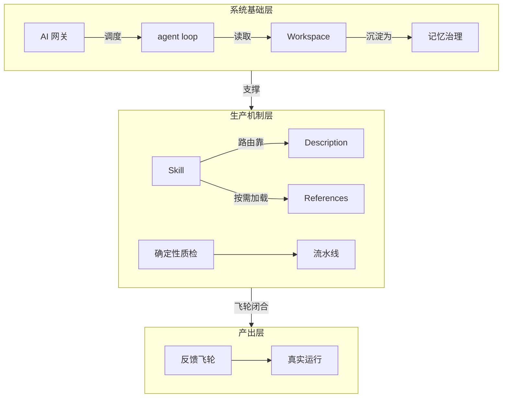
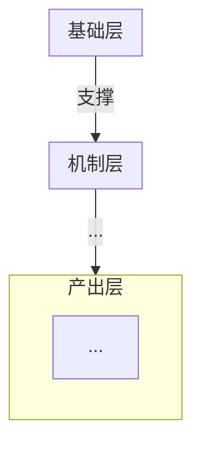

# 概念提取与费曼式解析

## 一、任务与定位

从学习材料中提取作者用来搭建思想的核心概念，为每个概念保留它在原文中的语境，用费曼式语言解析，并重建概念之间的拓扑关系。读者是广义的终身学习者：可能对该领域不熟悉，需要靠这份产出快速拿到一套能用的钥匙。

三级笔记给读者一张地图（讲了什么、怎么讲、骨架长什么样）；概念辞典给读者一套钥匙（靠哪些术语撑起来、每个术语什么意思、彼此如何咬合）。同一篇材料两者可以都做，互不替代。

产出物只有一份概念辞典，不产出三级笔记，不产出行动方案。

## 二、三条优先级裁决

执行中一定会遇到互相冲突的要求。按这个顺序裁决，不要临场权衡：

1. **保留证据 > 简洁。** 措辞可以压，证据不可以压。数字、阈值、端口、命令、文件名、价格、周期、链接、专名，一律逐字进正文。
2. **逐字引用 > 流畅转述。** 引号里的东西必须能在源稿里 grep 到。做不到逐字，就去掉引号，明写是转述。
3. **承重概念全收 > 数量好看。** 清单长不是缺点。漏掉一个承重概念是缺陷，多收一个边缘概念只是噪音。

**裁决条款：当「简洁」「可读性」「篇幅好看」与「保留证据」冲突时，一律保留证据。** 不折中，也不许用「读者应该看得懂」绕过。要删的那段先判它属于谁：属于源稿的证据、原话、术语、数字、链接、事故过程，留；属于源稿的口头填充、寒暄、推广话术，删；属于你自己写的铺垫和连接，压到最短。

**压缩额度只发给你自己写的连接性文字**：小节之间的过渡、caption、分层依据、走图说明、支撑概念的那一句话。这些地方一句能说清就不写两句。

**六个字段里的解释句不在压缩额度内。** 它们有长度下限（`费曼一下` 3–6 句，且必须含类比或对照）。把「说得短」当通用美德，产出的就是同义反复式释义，这是这份任务最常见的失效形态。源稿内容、原文引文、作者术语、数字与阈值，不受任何行文风格要求管辖。

## 三、输入判定与来源声明

动笔前先确认手里是什么，并在产出的来源行里写清楚。

| 输入类型 | 判定特征 | 处理方式 |
|---|---|---|
| `clean_article` 清洗稿／成稿 | 段落完整、无时间戳、标题成体系 | 直接作为引文源 |
| `raw_transcript` 原始转写 | 有时间戳、口语重复、ASR 误识别 | 引文照抄原样，ASR 可疑处标「待核」，不替讲者猜专名 |
| `index_page` 索引页／摘要页 | 只有条目和小标题，没有连续论述 | **不能单独作为引文源**，必须配完整文稿 |

**索引页与完整文稿并存时，强制交叉复核。** 概念框架可以从索引页起手，但每条 `context` 的出处必须写实际摘引的那个文件名。禁止框架取自索引页、引文偷自文稿而不声明。两处对同一名词的写法（产品名拼写、价格写法、术语大小写）不一致时，以完整文稿为准，并在该概念下写一句差异说明。

**人工标记优先。** 读者已经读完并用下划线标出概念时，只完成标记的提取任务，不自行增删。标记概念在源稿里找不到支撑句时，写明 `context 缺失：源稿无对应原句，本条释义来自标记位置的上下文推断`，不许拿转述冒充引文。

## 四、概念密度标尺与分布覆盖

**没有数量上限。** 数量由源稿的承重密度决定，不由整数美感决定。

计量单位统一为**非空白字符**（下称「字」）。先量出来再估：

```bash
python3 -c "import re,sys;t=open(sys.argv[1],encoding='utf-8').read();print(len(re.sub(r'\s','',t)))" 源稿.md
```

### 全局分档

字数对清洗稿算，不对原始转写稿算。量出字数后，从这一档取三个数，写进工作草稿，后面每一步都拿它对账。

| 清洗稿字数 | 核心概念密度 | 核心概念下限 | 每千字落点下限 |
|---|---|---|---|
| < 8,000 | 每 1,200–1,800 字一个 | 6 个 | 1.4 条 |
| 8,000–25,000 | 每 2,000–3,000 字一个 | 8 个 | 0.8 条 |
| > 25,000 | 每 2,500–4,000 字一个 | 12 个 | 0.6 条 |

**落点** ＝ 产出里为该段源文字负责的条目，核心概念与支撑概念都算一条。

密度与下限冲突时取大的那个：6,000 字按密度只估出 4 个，仍然要交 6 个。不足 3,000 字的短材料按密度上界取，核心下限降到 4 个，并在文件头写明字数。

### 原文覆盖率下限（密度达标不等于达标）

概念数够、字段齐，仍然可能整篇是凭记忆转述——密度只数条目，不管条目里的字是否来自源稿。所以另设一道闸：按 12 字窗口滚动比对源稿与产出，统计**源稿被覆盖的字符占比**。

| 清洗稿字数 | 原文覆盖率下限 |
|---|---|
| < 8,000 | ≥ 22% |
| 8,000–25,000 | ≥ 20% |
| > 25,000 | ≥ 15% |

实测锚点：不合格产出 3.1%，合格产出 51.4%——相差 16.6 倍，20% 这条线在两端都留足余量。**只有这两个样本，属单样本校准**，多跑几份后按实测回填，不要当已验证的。回填时只写能重算出来的数：标了「实测」却复现不出的数字，比没有数字更坏。

照抄率同样不设独立上限：它 ≈ 原文覆盖率 ÷ 体量，是派生量，交付时只算残差 ＝ 实测照抄率 − 覆盖率 ÷ 体量。

**残差为正时先分清两种来源，再决定改不改。** 同一段源稿在产出里被引多次，可能是同一个概念内部反复引同一句（可合并），也可能是多个概念各自引到源稿同一句（六字段要求每条 `context` 自带引文，本来就会这样）。只有前者是要动手的信号：回到那一条，把重复的 `context` 并成一句。判据是结构性的，读自己的产出就能判——那段源稿的重复出现，是挤在一个概念名下，还是分散在几个概念名下。

**判决只看可合并那一份，不看总残差。** 实测一份合格产出：被引 ≥2 次的源片段 731 个，其中 591 个（80.8%）分散在不同概念名下，140 个（19.2%）挤在同一个概念内部；总残差 +5.9 点，拆开后可合并只占 +1.7 点。四份实测产出的可合并值全部 ≤ +1.8 点，而总残差随覆盖率一起涨——覆盖率越高，不同概念引到同一句的机会越多。所以拿总残差当上限，等于因为覆盖率达标而判不合格，与闸门一正面相冲。可合并超过 +5 点才回去合并；总残差高而可合并不高，如实报出来，不要删 `context` 去凑。

闸门要的数一次算出来。覆盖率、照抄率、残差拆分都手算不出来，必须跑：

```bash
python3 - 源稿.md 产出.md <<'PY'
import sys, re
L = 12
ws = lambda t: re.sub(r'\s', '', t)
raw_s = open(sys.argv[1], encoding='utf-8').read()
raw_o = open(sys.argv[2], encoding='utf-8').read()
a, b = ws(raw_s), ws(raw_o)
A = {a[i:i+L] for i in range(len(a)-L+1)}
B = {b[i:i+L] for i in range(len(b)-L+1)}
f = bytearray(len(a))
for i in range(len(a)-L+1):
    if a[i:i+L] in B: f[i:i+L] = b'\x01'*L
c_src = sum(f)
head, hid, pos = [0]*len(b), 0, 0
for ln in raw_o.split('\n'):
    st = ln.strip()
    if re.match(r'^#{1,6}\s', st) or re.match(r'^\d+\.\s*\*\*', st): hid += 1
    n = len(ws(ln))
    for i in range(pos, min(pos+n, len(b))): head[i] = hid
    pos += n
f_all, f_fph, f_glb = bytearray(len(b)), bytearray(len(b)), bytearray(len(b))
sg, sf = set(), set()
for i in range(len(b)-L+1):
    w = b[i:i+L]
    if w not in A: continue
    f_all[i:i+L] = b'\x01'*L
    if w not in sg:
        sg.add(w); f_glb[i:i+L] = b'\x01'*L
    k = (w, head[i])
    if k not in sf:
        sf.add(k); f_fph[i:i+L] = b'\x01'*L
n_all, n_fph, n_glb = sum(f_all), sum(f_fph), sum(f_glb)
cov, cp, vol = c_src/len(a)*100, n_all/len(b)*100, len(b)/len(a)*100
exp = cov/vol*100 if vol else 0.0
print(f"源稿 {len(a)} 字 / 产出 {len(b)} 字 / 标题 {hid} 个")
print(f"覆盖率 {cov:.1f}%  照抄率 {cp:.1f}%  体量 {vol:.1f}%  预期 {exp:.1f}%")
print(f"残差 {cp-exp:+.1f} 点 ＝ 可合并 {(n_all-n_fph)/len(b)*100:+.1f} ／ 跨概念 {(n_fph-n_glb)/len(b)*100:+.1f} ／ 口径 {(n_glb-c_src)/len(b)*100:+.1f}")
PY
```

**覆盖率算的是「源稿被覆盖的字符占比」，不是「12 字窗口的集合占比」。** 集合写法更短、看着等价，实测低报 13–24 点，会把达标产出判成严重不达标，接着去多抄原文。模板里那几个数就用这个计算器的输出填，不要凭感觉估。

**支撑概念不设上限**，下限是不少于核心概念的实际条数。第 3 阶段的覆盖审计只会把这个数往上抬——凡是源稿里承重但没进核心概念的术语，都落到这一层。

估算值只是起点，不是闸门。超出估算 1.5 倍时回头自查是否在凑名词（判据：删掉它，读者理解这篇材料会不会变难），**但不因为超额而删掉任何承重概念**。低于本档下限或每千字下限时不要交付，回第 1 阶段补。

两层的区别只在字段数量，不在重要性：核心概念填满六个字段并进架构图；支撑概念写三行简写。不要把「说不清楚的概念」降级成支撑概念——说不清楚是补读的信号，不是降级的理由。

### 单段落点下限（比全局下限更要紧）

全局达标会掩盖尾部塌缩。实测病例：同一份笔记内部段间保留率差 3 倍——前段 50% 以上，尾段 17%——而全局数字仍然落在合格区间里。全局是平均数，平均数被前段的富余买单，尾段读薄了从总数上看不出来。

所以段落地图里**每一段单独判定**，取下面两条线里较大的那个，向上取整，任何一段都不许为 0：

- **档位线** ＝ 该段字数 ÷ 1,000 × 本档每千字落点下限 × 0.7
- **同篇线** ＝ 该段字数 ÷ 1,000 × 本篇实际落点密度 × 0.7

档位线在 Phase 0 就能算出来，写进段落地图。同篇线要等产出成型后在 Phase 3 补算，它防的是另一种情况：全篇密度远高于档位下限时，档位线太松，尾段照样能塌。

例：36,000 字源稿落在 > 25,000 档，产出 45 条落点（实际密度 1.25 条／千字）。一个 1,800 字的段落，档位线 ＝ 1.8 × 0.6 × 0.7 ＝ 0.76 → 1 条；同篇线 ＝ 1.8 × 1.25 × 0.7 ＝ 1.58 → 2 条。取 2 条。两条都过才算这一段读完了。

**0.7 这个系数就是为了让同篇线可满足，不要漏掉它。** 有过一次实测反馈说「同篇线由全篇均值反推，数学上不可能全段同时达标——任一段高于均值必然把别的段压到均值以下」。这个推理只对**不带系数**的版本成立：不带 0.7 时各段线之和 ＝ 总字数 × 均值密度 ＝ 总落点，于是任一段有富余就必然有另一段亏空。带上 0.7 之后，各段线之和只有总落点的 70%，留出 30% 余量，一段要跌破线得低于全篇均值密度的七成——那是真的读薄了，不是算术必然。

所以「这条规则数学上不可能满足」不能作为未达标的理由。真的有段跌破 0.7 倍均值，就回该段重扫；扫完确认没有承重概念可立，在对账表里写明该段字数、落点数、线值和判定理由，**不要为凑数增设非承重落点**，也不要把系数抹掉再宣布规则无解。

### 分布覆盖

过度压缩在概念提取上的形态不是总数不够，是分布不匀：前半篇抽 15 个、后半篇抽 3 个，总数看着很体面。

把源稿**按字数四等分**，逐份数落点：

- 任何一份的落点数不得低于最多那一份的 **0.5 倍**。
- 每一份至少含 **1 个核心概念**。做不到，说明那部分的论证被你当成了注脚。

修正只能往一个方向走：**回去重扫覆盖不足的那几段**。删前半篇的概念来拉平比例，是把缺陷改成更大的缺陷。

### 事故与踩坑单独立条

作者亲历的失败、踩坑、线上事故所对应的概念，是这份材料里最难从别处获得的部分——教程会讲原理，不会讲具体谁在什么条件下栽了、代价多大、怎么爬出来。

- **不得与相邻概念合并，不得压成一句话。** 作者给了名字的（哪怕是绰号、口头说法）进核心层。
- `context` 引文要覆盖过程要素：**触发条件、症状、代价（数字／时长／金额）、恢复动作**。能逐字抄的逐字抄；源稿没给的那一项写「源稿未给」，不用含糊说法补位。
- 作者没给名字的，不要自己发明概念名去凑，挂到最近的核心概念下作支撑概念，但过程要写全——这一条允许超出支撑概念的三行限制。
- `费曼一下` 里禁止把事故抽象成「要注意 X」。事故的价值全在具体条件，抽象掉条件等于删掉它。

## 五、五个执行阶段

四遍读全在脑内、无草稿、无核对，是引文退化成转述的根源。以下每个阶段都要留下可见的中间产物。

### Phase 0 侦察（先做，便宜）

量体积、判类型、按自然边界（一级／二级标题，或话题转折）切段，产出**段落地图**。地图是产物，写进工作草稿，不是脑内印象。

```
| 段号 | 定位（标题或首句） | 主题 | 字数 | 落点下限 |
|------|------------------|------|------|---------|
| S1   | ### ...          | ...  | ...  | ...     |
```

切段粒度：每段 800–2500 字。超过 2500 字的自然段落继续切。

`落点下限` 填第四节的档位线（该段字数 ÷ 1,000 × 本档每千字下限 × 0.7，向上取整，最少 1）。这一列是后面每一步的对账基准，Phase 0 不算出来，Phase 3 就只剩全局数字可看。

### Phase 1 逐段候选扫描（防压缩主力）

**每一段都要单独过一遍，一段一条记录。** 禁止通读一遍后凭印象直接写辞典。

每段产出：

```
段号：S3
候选概念：术语 A、术语 B、术语 C……（含英文名、反引号里的文件名、命令、数字阈值）
必留原话（逐字，含标点）：「……」
作者自创说法：……
该段进入正文的落点数：N
```

**源稿超过 15,000 字时，分段派 subagent**，每个 agent 领 3–5 段。八个 agent 各读一万多字，不会像单个上下文读九万字那样压扁尾部。

派发时 prompt 必须包含四项，缺一项该 agent 就会自行压缩：

1. 段落原文（整段贴进去，不要只给标题让它自己找）
2. **该段的候选概念下限**：按 `该段字数 ÷ 600` 向下取整，最少 3 个。这是候选，不是终选，宁多勿少。同时把段落地图里这一段的 `落点下限` 一并写给它，让它知道这段最后至少要留下几条，不能交回空段。
3. 逐字要求：必留原话必须整句复制，含原有标点与引号，不许截断、不许改标点
4. 返回 schema（下方）

```json
{
  "segment": "S3",
  "chars": 1840,
  "candidates": [
    {
      "term": "原文术语",
      "en": "英文名或 null",
      "quote": "逐字整句，含标点",
      "quote_source": "源稿文件名",
      "why_load_bearing": "一句话：删掉它读者会难在哪",
      "author_coined": true
    }
  ],
  "verbatim_musts": ["数字、端口、命令、文件名、价格、链接原样"],
  "discardable": ["本段可弃项及理由"]
}
```

**无 subagent 能力时的串行退路**：逐段显式深读，一段一条记录写进草稿文件，写完一段再读下一段。不允许合并处理多段，不允许跳段。

### Phase 2 分层与架构图设计

把 Phase 1 的候选合并去重，判定核心／支撑两层，然后**先画架构图，再写字段**。

顺序不能反。先写完释义再补图，图一定沦为装饰；先画图，画不进去的概念会立刻暴露出「我其实没搞清它跟别的概念什么关系」。

每个核心概念在这一步就要定下 `在架构图中的位置`，图上没有位置的概念不能进核心层。

### Phase 3 回源核对与覆盖审计（唯一的锚点验证）

自评不可靠，必须锚回源稿。这一步不做，前面全部白做。

**3.1 逐条 grep 引文**

对每一条 `context`，拿引文里最有辨识度的连续片段（12 字以上，含数字或专名更好）去源稿查：

```bash
grep -c -F "把确定性判断交给代码，再用测试证明它真的按预期工作" 源稿.md
```

- 命中 ≥1：保留引号。
- 命中 0：换更短片段再试一次，确认不是标点差异。仍然 0，则二选一——回源稿重新整句复制，或**去掉引号并改写成 `转述：……`**。

**「」只归逐字引文，自拟命名一律用加粗。** 概念提取的产出里自拟的东西特别多——概念名、小节名、分层名、走图说明里的层名。这些一旦套上「」，读者会当成作者原话，回头核对的人也分不清哪些该去源稿 grep。实测一份产出：全文 197 处「」里 25 行落在标题上，逐字核对判为未命中的 17 条里，8 条就是这类自拟概念名——不是引文造假，是标记用错，但机械核验分不出来，只能算成未命中。所以：从源稿逐字复制的用「」并且能 grep 到；你自己起的名字、你的概括、你要强调的词，用加粗，不用「」。

三个必查的退化形态，实测最常见：

1. **句中截断**。原句还有后半句就补上句号，看起来像完整引文，实则删掉了承重信息（`核心组件叫 Gateway`、端口号、第三个并列项，都是这样丢的）。引文必须切在原句句号处；确需节略用「……」标出，且前后片段各自逐字。
2. **引号内压缩**。三项并列删成两项、把「文件读写、命令执行、浏览器控制、定时任务」缩成「文件、命令、浏览器和定时任务」。引号内一个字都不能动。
3. **标点改写**。全角改半角、直角引号改弯引号、顿号改逗号。照抄原样。

**3.2 覆盖审计**

对账段落地图，确认不是前密后疏。

```bash
python3 - <<'PY'
import re
src = open('源稿.md', encoding='utf-8').read()
prod = open('产出.md', encoding='utf-8').read()
# 候选术语：英文词组、反引号内名称、带单位数字、点号文件名
cand = set(re.findall(r'[A-Za-z][A-Za-z0-9_.\-]{2,}', src)) \
     | set(re.findall(r'`([^`]+)`', src)) \
     | set(re.findall(r'\d{3,5}', src))
rows = [(t, src.count(t)) for t in cand if src.count(t) >= 3 and t not in prod]
for t, n in sorted(rows, key=lambda x: -x[1]):
    print(f'{n:>3}  {t}')
PY
```

同时检查中文承重术语：把段落地图逐段的候选清单与产出对账，逐段确认落点。

**处理规则**：源稿出现 ≥3 次而产出里完全没有的术语，每一个都必须二选一——收进支撑概念，或写进「不提取的内容」并给一句理由。**不许静默漏掉**。

**3.3 逐段与分布对账**

先补算第四节的同篇线（该段字数 ÷ 1,000 × 本篇实际落点密度 × 0.7），与段落地图里已有的档位线取大值，逐段比：

- 落点为 0 的段，回该段重扫。
- 落点低于该段下限的，回该段重扫。**不许拿别段的富余抵**——尾段读薄了，不会因为前段厚而变厚，而全局平均数恰好会把这件事盖住。

再按字数把源稿四等分，逐份数落点与核心概念。最低那一份不足最高那一份的 0.5 倍，或某一份里没有核心概念，这一份覆盖的所有段落全部回扫。

### Phase 4 交付

自检写成 ≤5 行放文件头，全部是可核对的事实，不写「结构清晰」「覆盖完整」这类自我表扬。

## 六、核心概念的六个字段

每个核心概念六个字段全填，一个都不能省。

**1. 原文术语／英文名**

用作者的原词做标题，不换成学术词。作者自创的生动说法（比喻、绰号、口语模型名）原样保留在标题里。有英文原名或原文术语的，用括号附上。

**2. context**

逐字原文引用 + 出处文件名。格式：

```
- **context**：
    > 「逐字整句，含原有标点。」
    > —— `01_源稿文件名.md`
```

一条引文不足以锚定含义时，可以给两条，各自标出处。引文优先选**定义句和对照句**，不选概述句。无原文支撑就写来源限制，不许无声转述。

**`>` 引用块只放源稿逐字整句，不放你自己的话。** 自检行、小节说明、过渡句都不用 `>`，改用 `-` 或加粗。两种用途共用一个记号，回源核对就分不出哪条本该在源稿里找得到——实测三份产出的 9 条「引文未命中」全部出自这一处混用，没有一条是真编造。

**3. 费曼一下**

**3–6 句，必须含一个类比或一组对照。** 少于 3 句判干瘪，退回重写。

可用的句式骨架：第 1 句给类比或对照（把它比成什么，或它跟什么不是一回事）；中间 2–4 句拆机制（它由什么组成、怎么运转、代价是什么）；末句收到「所以它在这篇材料里管什么」。

不要写成词典释义。反面：`确定性质检：用代码对确定性规则做检查。` 这是同义反复，没有增加任何理解。正面要能给出对照：哪些判断有唯一答案适合脚本，哪些没有唯一答案必须留给人。

作者的生动说法在这里也要保留，不要抽象成干瘪学术词。

**4. 作者为什么需要它**

作者引入这个概念是为了解决他论证里的什么麻烦、堵住哪个漏洞、区分哪两件容易混的事。写「作者的目的」，不是写「概念的用途」。答不出来的，说明它可能不承重，降级为支撑概念或剔除。

**5. 不要误解为**

给一条防误用的边界，最容易被读者读歪的那条。优选形态：与某个相邻概念的区别，或一个常见的过度推论。

**6. 在架构图中的位置**

格式：`层名｜与 X（关系动词）｜与 Y（关系动词）`

例：`系统基础层｜调度 → agent loop｜被 Workspace 约束`

这个字段是强制机制。填不出来，就是关系没想清楚，架构图也画不出来——回 Phase 2，不要跳过。

## 七、支撑概念的简写

```
- **术语（英文名）**：一句话说清它在本文中指什么。归属：`核心概念名`。出处：`文件名`。
```

三行以内。不写费曼解析，不写边界。只回答「它是什么」和「它挂在哪个核心概念下」。

唯一例外是第四节的事故与踩坑：作者没给名字、只能落到这一层的失败案例，触发条件、症状、代价、恢复动作要写全，允许超出三行。

覆盖审计捞出来的高频术语、只服务局部论证的产品名和例子名、作者一次性提到但承载具体规格的东西（端口、命令、脚本名），都落在这一层。

## 八、分层架构图

用分层 mermaid 替代 bullet 概念网络。bullet 链只能表达线性顺序，丢掉了拓扑：谁支撑谁、哪两个对立、哪一层塌了上面全塌。

### 形态



### 怎么决定分几层

层数 **2–4 层**，由概念承担的**功能角色**决定，不由概念数量决定。

判定动作：逐个问每个核心概念「它在作者的论证里干什么活」，答案会自然聚成几类——提供运行基础的、把基础变成产能的、产出结果的、约束前三者的。答案聚成几类就是几层。

三条校验，任何一条不过就重分：

1. **层名必须是功能名。** 基础层／机制层／产出层／约束层这类可以；「第一组／第二组」「上半部分／下半部分」不行——那说明你在按出场顺序分层。
2. **删层测试。** 把下层整层删掉，上层还能不能成立？还能成立，说明它不是上层的基础，分层错了。
3. **超过 4 层就是在按话题分层。** 合并功能重复的层。

同层内部也可以有边，跨层的边挂在 subgraph 之间（`L1 -->|支撑| L2`），不要把跨层关系画成两个概念间的散边。

### 什么进图、什么不进

**必进**：全部核心概念。一个都不能漏——漏掉的说明第六个字段没填就交了。

**可进**：支撑概念中，充当两个核心概念之间唯一连接件的那些。它不进图，图上就断链。

**不进**：一次性举例、人名、产品对比里的陪衬项、纯规格数字（端口、价格留在字段里）、以及你自己发明的分类名。作者没这么分，图上就不能这么分。

**对立关系要画。** 作者用来对照的两个概念（手动模式／流水线模式、Cron／Heartbeat）是承重的，画成同层两个节点 + 一条 `对立` 或 `校正` 边，不要只留一个。

### 边

**每条边必须带关系标签**，语法 `A -->|关系动词| B`。可用动词：支撑、调度、读取、沉淀为、约束、校正、导致、对立、递进、包含、应用于、反例是。

一条边要能填进「A 对 B 做了什么」并且**这个关系在源稿有依据**。填不出动词的边直接删掉——那是联想，不是作者的论证。

### 图外必须补两样

1. **分层依据一句话**：为什么这么分层，判据是什么。
2. **走图说明 2–4 句**：从最底层沿主路径走到顶层，说出这条路径讲的是什么。读者不看图只读这几句，也要能拿到主干。

## 九、图片策略

全文 **≤6 张**，架构图不计入。

**保留**：框架图、数据图、流程图、对照表、讲义结构页。
**删除**：装饰图、人像、logo、纯文字截图。

**图从哪来**

源稿本身通常不带图——实测四份源稿图片数全为 0，而语料库里唯一带图的笔记 26 张图全部来自课程幻灯片资产目录。所以动笔前先找图池：查源稿同级或上级目录有没有 `assets/`、`slides/`、`screenshots/`，文件名通常带讲次与序号，按序号与本讲对齐挑图。

找不到可用图池，就在交付自检里显式写「图片 0 张，原因：未找到可用图池」。把「没有图」写成显式判定，不要默默交 0 张——下一轮才分得清是没找到还是根本没有。

两种合法来源：本地相对路径 `../assets/xxx.png`；远程课程平台 CDN 链接。**原始路径／URL 逐字保留**，不改写、不下载、不新建目录。

每张必须：

- 有说明性 caption，写清「看这张图的什么」+ 它锚定哪个概念
- 紧跟被它支撑的那个概念之后，不聚在末尾

两条红线：

1. **图片只作阅读脚手架，不承担正文职责。** 判据是删图测试：把所有图删掉，笔记还能不能独立读完。读不成，说明图在替正文干活。所以禁止用「见图」「如图所示」「见下图」替代文字说明，禁止把关键信息只放在 caption 里。图里的数字、层级关系、对照结论，正文要另外用文字写出来。
    **判定方式**：把正文里所有图片行（`` 形态：感叹号、方括号图注、圆括号路径）遮掉通读一遍，每个概念的 `context`、`费曼一下`、`在架构图中的位置` 都必须仍然读得通。读到「这里缺了点什么」的位置，就是那张图正在替正文干活，把它承担的内容补成文字。
2. **图片不顶掉文字。** 图片不做章节开头，前后都要有文字。

## 十、输出模板

照着填，字段名不改。

**头部每一个数先量后写，零填判交付失败。** 交付前拿定稿实际跑一遍第四节的计算器，用它的真实输出填覆盖率、照抄率、体量、残差与字数，计数类（四等分落点、引文命中）按 Phase 3 的对账结果填，一个都不许凭印象估。`[N]` 是待填标记，不是写成 `00.0%`、`000.0%`、`0000 字`、`+0.0` 的许可：零填比留 `[N]` 更坏，`[N]` 一眼看得出没填，一排 0 能骗过「占位符已清空」这类检查，读起来像真测过。确实量不出来的那一项，如实写「未测：原因」，不许拿 0 冒充——这是第十二节「答不出数字的那条就是没做」的一个具体形态。

````markdown
# [文章标题]｜概念提取

- 源稿：`[文件名]`（[作者]，[出处]）｜输入类型：[clean_article／raw_transcript／index_page + 完整文稿]｜人工标记：[有（下划线 N 处）／无]
- 源稿 [N] 字（[档位]，核心下限 [N]，每千字落点下限 [N]）｜段落地图 [N] 段，全段达落点下限，最低段 [N] 条（下限 [N]）。
- 核心概念 [N] 个（密度估算 [N]–[N]），支撑概念 [N] 个；四等分落点 [N]/[N]/[N]/[N]，最低／最高 ＝ [N]（≥0.5），每份均含核心概念。
- 闸门一 原文覆盖率 [N]%（本档下限 [N]%）｜照抄率 [N]%，预期 ＝ 覆盖率 ÷ 体量 ＝ [N]%，残差 [±N] 点，其中可合并 [±N] 点（上限 +5 点）、跨概念 [±N] 点（不设上限）。体量 [N]%，仅报不设闸。
- 引文逐字命中 [N]/[N]，未命中 [N] 条已去引号改标转述；覆盖审计：源稿 ≥3 次出现的术语中 [N] 个收入支撑概念，[N] 个列入不提取（见文末）。
- 作者亲历事故 [N] 处，各自独立立条并写全过程要素；图片 [N] 张，遮图通读后正文自洽。

## 一、核心概念

### 1. **[原文术语]（[英文名／原文术语]）**

- **context**：
    > 「[逐字整句，含原有标点]」
    > —— `[出处文件名]`
- **费曼一下**：[3–6 句，首句给类比或对照，中间拆机制，末句收到它在本文管什么]
- **作者为什么需要它**：[作者引入它是为了堵住论证里的哪个漏洞、区分哪两件易混的事]
- **不要误解为**：[最容易被读歪的那条边界]
- **在架构图中的位置**：[层名]｜[关系动词] → [概念]｜[关系动词] → [概念]

### 2. **[下一个概念]**
...

## 二、支撑概念

- **[术语]（[英文名]）**：[一句话]。归属：`[核心概念名]`。出处：`[文件名]`。
- ...

## 三、概念架构图

**分层依据**：[一句话说明为什么这么分层]



**走图说明**：[2–4 句，沿主路径从底层走到顶层，说出这条路径讲的是什么]

## 四、不提取的内容

- `[术语]`（源稿出现 [N] 次）：[一句话理由]
- ...
````

## 十一、任务边界

只做概念提取与解析，不做这些：

- 不臆造源稿未提及的定义
- 不推荐行动建议、不给实施方案
- 不做价值判断或批评
- 不用外部理论替换作者本人的意思
- 不超出源稿范围补背景知识（例外：仅为解释一个术语的字面含义）
- 不把三级笔记当成原文引文
- 不省略 `不要误解为` 和 `在架构图中的位置`
- 不在提取任务里做破坏性文件操作或 git 操作

## 十二、交付前自检

八条，涉及源稿内容的判据一律锚回源稿，逐条能给出数字或文件位置。答不出数字的那条就是没做。

1. 核心概念数 ≥ 本档下限；支撑概念数 ≥ 核心概念实际条数；每个核心概念都有全部六个字段。
2. 每条 `context` 都 grep 过：命中数报得出来；未命中的已去引号标转述。
3. 段落地图逐段对过落点下限（档位线与同篇线取大）；没有落点为 0 的段。
4. 四等分落点数列得出来：最低一份 ≥ 最高一份的 0.5 倍，且每一份都含核心概念。
5. 覆盖审计跑过：源稿 ≥3 次出现的术语，没有一个是静默漏掉的。
6. 作者亲历的失败／踩坑／事故逐处独立立条：触发条件、症状、代价、恢复动作四项，每处都指得出它写在哪一行，缺的那项写着「源稿未给」。
7. 架构图里每个核心概念都在，每条边都有关系动词，分层依据和走图说明都写了；遮掉全部图片通读一遍，正文没有断口。
8. 三个闸门的数字都算过并写进自检行：原文覆盖率 ≥ 本档下限；残差已拆成可合并与跨概念两项，可合并 ≤ +5 点；体量如实报出。可合并超限的，指得出是哪个概念内部的哪一句被重复引了；总残差高而可合并不高的，照实写出来，不删 `context` 去压这个数。
